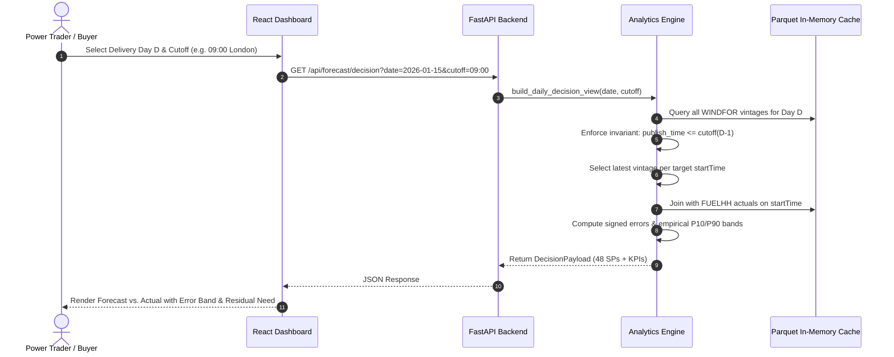

# GridBricks — System Architecture & Design Decisions

## 1. System Overview & Component Diagram

GridBricks is an institutional-grade web application built for UK day-ahead power procurement desks. It evaluates national wind generation forecasts against outturn actuals from Elexon BMRS for January 2026 delivery days, strictly adhering to day-ahead auction timing with **zero look-ahead leakage**.

```mermaid
flowchart TD
    subgraph Data Sources
        ELEXON_ACTUALS["Elexon BMRS FUELHH/stream\n(Half-Hourly Wind Actuals)"]
        ELEXON_FORECAST["Elexon BMRS WINDFOR/stream\n(Hourly Multi-Vintage Wind Forecasts)"]
    end

    subgraph Offline Ingestion
        INGEST["fetch_data.py\n(Chunking, Retries, Validation)"]
        ACTUALS_PARQUET[("actuals_wind_2026-01.parquet\n(1,488 rows)")]
        FORECAST_PARQUET[("windfor_forecasts_2026-01.parquet\n(18,080 rows)")]
        META_JSON[("snapshot_meta.json")]
    end

    subgraph Backend Container (FastAPI + Uvicorn)
        LOADER["data_loader.py\n(Startup In-Memory Cache)"]
        ANALYTICS["analytics.py\n(Pure Domain Logic & Invariants)"]
        
        subgraph REST API Endpoints
            HEALTH["/api/health"]
            META["/api/meta"]
            DECISION["/api/forecast/decision"]
            REVISIONS["/api/forecast/revisions"]
            WHAT_IF["/api/forecast/what-if"]
            ACCURACY["/api/accuracy/*\n(summary, daily, by-hour, by-horizon, error-dist)"]
        end
        
        STATIC["StaticFiles Middleware\n(Serves SPA from /frontend/dist)"]
    end

    subgraph Frontend Single Page App (React 18 + TypeScript)
        NAV["Navbar & Methodology Drawer"]
        VIEW1["Decision View\n(KPIs, Recharts Band, What-If, Schedule Table)"]
        VIEW2["Accuracy View\n(Trading Insight, MAE/WAPE/Bias, 4 Analytic Charts)"]
        VIEW3["Forecast Revisions View\n(Vintage Evolution Line Chart & Run Toggles)"]
    end

    ELEXON_ACTUALS --> INGEST
    ELEXON_FORECAST --> INGEST
    INGEST --> ACTUALS_PARQUET
    INGEST --> FORECAST_PARQUET
    INGEST --> META_JSON

    ACTUALS_PARQUET --> LOADER
    FORECAST_PARQUET --> LOADER
    META_JSON --> LOADER

    LOADER --> ANALYTICS
    ANALYTICS --> DECISION
    ANALYTICS --> REVISIONS
    ANALYTICS --> WHAT_IF
    ANALYTICS --> ACCURACY

    DECISION --> VIEW1
    WHAT_IF --> VIEW1
    ACCURACY --> VIEW2
    REVISIONS --> VIEW3
    STATIC --> NAV
```

---

## 2. End-to-End Data Flow



---

## 3. Key Architectural Decisions & Trade-Offs

### A. Committed Parquet Snapshots vs. Live API Calls at Runtime
* **Decision:** We execute a robust ingestion script (`fetch_data.py`) to download and validate Elexon BMRS data into compressed Parquet files committed to the repository. The application loads these files into memory upon startup.
* **Trade-Off:** The application filesystem on Heroku container dynos is ephemeral. Calling Elexon directly at runtime would introduce slow cold-starts, rate-limit risks, and potential downtime if Elexon maintenance occurs during market hours. Committing immutable Parquet snapshots guarantees zero-dependency runtime reliability, deterministic responses (<10ms latency), and reproducible test assertions.

### B. Single-Container Deployment (FastAPI Static Serving) vs. Separate Microservices
* **Decision:** A multi-stage Docker build compiles the Vite/React frontend in Stage 1 and copies `frontend/dist` into a lightweight Python 3.12 container in Stage 2. FastAPI serves the SPA statically on the same origin as the API.
* **Trade-Off:** Avoids configuring a reverse proxy (Nginx), avoids multi-dyno costs on Heroku, eliminates CORS issues in production, and provides single-origin authentication readiness.

### C. Pure Analytics Engine Separation
* **Decision:** All business logic, cutoff math, and metric algorithms are isolated in [`backend/app/analytics.py`](file:///d:/GridBricks%20Project/backend/app/analytics.py) as pure functions with no network or disk I/O.
* **Trade-Off:** Makes unit testing instantaneous (<0.2s for 18 tests) and mathematically auditable against hand-computed test fixtures.

### D. Timezone & Look-Ahead Leakage Guarantee
* **Decision:** All timestamps are internally parsed and stored as UTC-aware `datetime` objects. The D-1 cutoff logic explicitly applies `ZoneInfo("Europe/London")` on day $D - 1$.
* **Trade-Off:** Because January is in Greenwich Mean Time (GMT), UTC offset is $+0$. However, using explicit London timezone objects guarantees that summer time transitions (BST) would not break the core domain logic if extended to other delivery months.
