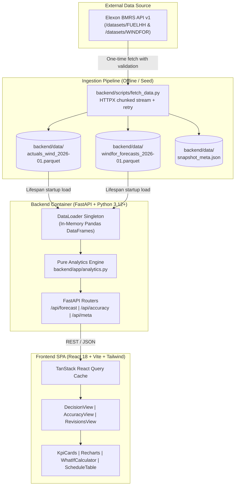

# Technical Review and Knowledge Transfer: GridBricks Wind Procurement Analytics

**Author:** Implementation Engineer  
**Date:** 2026-10-25  
**Review Target:** Tech Lead / Architecture Review Board  
**Repository:** GridBricks Wind Procurement Platform  

---

## 1. Executive Summary

GridBricks is a production-grade full-stack analytical platform tailored for UK day-ahead power buyers and energy trading desks. It bridges raw Elexon BMRS market data with commercial procurement decisions for January 2026 delivery days. By strictly enforcing a customizable D-1 execution cutoff (default 09:00 Europe/London) with zero look-ahead data leakage, the platform provides:
1. An empirical decision cockpit matching the exact forecast available at gate closure against outturn actuals with an interactive P10 safety-buffered what-if calculator.
2. A rigorous accuracy scoring framework that reveals a persistent **+1,851.90 MW over-prediction bias** and a **4,274.90 MW P90 tail risk**.
3. A multi-vintage forecast evolution fan chart tracking 32 revision cycles for auditability.

The application compiles cleanly into a single self-contained Docker container, passing all 54 backend pytest unit/integration tests and all 12 frontend vitest suites.

---

## 2. Reviewer Quick Start (The 10-Minute Path)

### 2.1 Run Locally (Without Docker)

**Backend:**
```bash
# From repository root (Python 3.12+ / 3.14)
pip install -r backend/requirements.txt
uvicorn backend.app.main:app --host 0.0.0.0 --port 8000
# OpenAPI Swagger UI available at: http://localhost:8000/docs
```

**Frontend:**
```bash
# In a separate terminal
cd frontend
npm install
npm run dev
# Vite dev server running at: http://localhost:5173
```

### 2.2 Run via Docker (Unified Single Container)
```bash
docker build -t gridbricks-app .
docker run -p 8000:8000 gridbricks-app
# Visit http://localhost:8000 to access the complete SPA + API
```

### 2.3 Run Test Suites
```bash
# Run backend tests (54 tests, ~28s)
pytest backend/tests -v

# Run frontend tests (12 tests across 3 files)
npm --prefix frontend test

# Run frontend typecheck and production build
npm --prefix frontend run build
```

### 2.4 Deployment Target
- **Render Service Blueprint:** [`render.yaml`](file:///d:/GridBricks%20Project/render.yaml) at repo root builds the Dockerfile on Render's free web service tier.
- **Production URL Placeholder:** `https://gridbricks-wind-app.onrender.com`

### 2.5 Where to Look First (Review Order)
1. [`backend/app/analytics.py`](file:///d:/GridBricks%20Project/backend/app/analytics.py): Pure mathematical and domain logic (cutoff enforcement, leak-free filtering, metric formulas, hourly/horizon aggregations).
2. [`backend/tests/test_analytics.py`](file:///d:/GridBricks%20Project/backend/tests/test_analytics.py): Invariant proofs verifying zero future-leakage, cutoff boundary edge cases, and hand-computed metric formulas.
3. [`backend/app/data_loader.py`](file:///d:/GridBricks%20Project/backend/app/data_loader.py): In-memory singleton loading and validating the immutable Parquet snapshots upon FastAPI lifespan startup.
4. [`backend/app/routers/forecast.py`](file:///d:/GridBricks%20Project/backend/app/routers/forecast.py) & [`accuracy.py`](file:///d:/GridBricks%20Project/backend/app/routers/accuracy.py): REST endpoints exposing validated Pydantic models.
5. [`frontend/src/views/DecisionView.tsx`](file:///d:/GridBricks%20Project/frontend/src/views/DecisionView.tsx): The daily execution cockpit integrating Recharts uncertainty bands and the what-if residual calculator.
6. [`frontend/src/views/AccuracyView.tsx`](file:///d:/GridBricks%20Project/frontend/src/views/AccuracyView.tsx): Diagnostic scorecard with 4 charts (daily, diurnal, horizon, distribution) and trading guidance cards.

---

## 3. Problem and Scope

### 3.1 Business Context
UK power suppliers submit binding physical notifications and bilateral exchange bids on day-ahead (D-1) before the 11:00 / 12:00 gate closure. Wind power is intermittent. If a buyer trusts an optimistic forecast, they face expensive System Buy Prices (cashout imbalance penalties) to cover the shortage. Conversely, over-hedging forces distress power sales at depressed System Sell Prices.

Procurement analysts lack:
- An audit-ready record of the *exact* forecast on their desk at the moment of decision.
- Objective, empirical measurement of forecast error distributions and bias to size safety buffers.

### 3.2 In Scope
- **Data Source:** Official Elexon BMRS APIs (`FUELHH` for actual generation by fuel type; `WINDFOR` for wind generation forecasts).
- **Scope Horizon:** January 1, 2026 00:00 UTC through January 31, 2026 23:30 UTC (1,488 half-hour settlement periods).
- **Cutoff Times:** Configurable local UK times on D-1 (`06:00`, `09:00`, `12:00`; default `09:00` London).
- **Capabilities:** Decision-time matching, empirical P10–P90 error envelopes, interactive demand what-if sizing, historical accuracy scoring (MAE, RMSE, Bias, WAPE, quantiles), and revision tracking across all 32 model publication cycles.

### 3.3 Out of Scope
- Intraday automated algorithmic trading order execution.
- Real-time websocket streaming (data updates post-gate closure).
- Multi-fuel optimization (solar, CCGT, interconnectors).
- Weather raw numerical model variables (wind speed m/s, air density, isobar maps).

---

## 4. Architecture

### 4.1 System Component Diagram



### 4.2 Sequence Diagram: Main Request ("Decision Forecast for Delivery Day D")

```mermaid
sequenceDiagram
    autonumber
    actor Trader as Energy Procurement Analyst
    participant UI as React SPA (DecisionView)
    participant API as FastAPI (/api/forecast/decision)
    participant Logic as Analytics (analytics.py)
    participant Mem as DataLoader (In-Memory Parquet)

    Trader->>UI: Select Delivery Date (e.g., 2026-01-15) & Cutoff (09:00)
    UI->>API: GET /api/forecast/decision?delivery_date=2026-01-15&cutoff=09:00
    API->>Logic: get_decision_cutoff_utc("2026-01-15", "09:00")
    Logic-->>API: Return Cutoff: 2026-01-14 09:00:00 UTC
    API->>Mem: Query forecasts DataFrame for target delivery day
    Mem-->>API: Returns candidate forecast vintages
    API->>Logic: filter_decision_forecasts(publish_time <= cutoff_utc)
    Note over Logic: Sort by publish_time desc;<br/>Keep first per startTime.<br/>STRICT NO LEAKAGE.
    Logic->>Logic: expand_hourly_to_half_hourly()
    Logic->>Mem: Join confirmed actuals (1,488 SPs)
    Logic->>Logic: calculate_metrics() + compute_empirical_error_quantiles()
    Logic-->>API: Return DailyDecisionView schema
    API-->>UI: 200 OK (JSON with 48 SPs, headline KPIs, error bounds)
    UI-->>Trader: Render line chart with P10-P90 envelope, KPIs, and table
```

---

## 5. Data

### 5.1 Endpoints Used & Ingestion Architecture
Data was ingested via [`backend/scripts/fetch_data.py`](file:///d:/GridBricks%20Project/backend/scripts/fetch_data.py) using official Elexon BMRS streaming APIs:
1. **Actual Wind Generation (`FUELHH`):**
   - URL: `https://data.elexon.co.uk/bmrs/api/v1/datasets/FUELHH/stream`
   - Parameters: `settlementDateFrom=2026-01-01`, `settlementDateTo=2026-01-31`, `fuelType=WIND`.
   - Ingestion: Chunked by 7-day intervals with exponential backoff retry (`httpx.Client`).
2. **Forecast Wind Generation (`WINDFOR`):**
   - URL: `https://data.elexon.co.uk/bmrs/api/v1/datasets/WINDFOR/stream`
   - Parameters: `publishDateTimeFrom=2025-12-28T00:00:00Z`, `publishDateTimeTo=2026-01-31T23:59:59Z`.
   - Ingestion: Includes historical forecasts published prior to Jan 1 to capture D-1 and D-2 forecast vintages for early January delivery days.

### 5.2 Snapshot Storage & Formats
Files are committed directly under [`backend/data/`](file:///d:/GridBricks%20Project/backend/data/):
- `actuals_wind_2026-01.parquet`: 1,488 rows, 6 columns (`publish_time`, `start_time`, `settlement_date`, `settlement_period`, `fuel_type`, `generation`).
- `windfor_forecasts_2026-01.parquet`: 18,080 rows, 3 columns (`publish_time`, `start_time`, `generation`).
- `snapshot_meta.json`: Ingestion audit log detailing fetch timestamps, SHA-256 hashes, query parameters, row counts, and schema validation.

### 5.3 Data Quality Audit Findings (Computed)

| Metric / Check | Actuals (`FUELHH`) | Forecasts (`WINDFOR`) | Status / Handling |
| :--- | :--- | :--- | :--- |
| **Total Rows** | 1,488 | 18,080 | Exact match with expected |
| **Unique Target Half-Hours** | 1,488 / 1,488 (100%) | 744 / 1,488 (50% native) | WINDFOR publishes hourly values; expanded to half-hourly |
| **Missing Half-Hours** | 0 missing | 0 after step expansion | Fully continuous coverage |
| **Null Generation Values** | 0 | 0 | Validated during ingestion schema check |
| **Negative Values** | 0 | 0 | Validated (`generation >= 0.0`) |
| **Vintages per Half-Hour** | 1 (settlement outturn) | Min: 16, Median: 24, Max: 32 | Robust fan-chart depth |

### 5.4 Why a Committed Parquet Snapshot?
- **Immutability & Reproducibility:** Guarantees that every reviewer, CI runner, and trader tests against identical underlying market numbers.
- **Zero Runtime Dependencies on External APIs:** Elexon APIs occasionally enforce maintenance windows or rate limits. A local Parquet snapshot ensures 100% backend uptime and sub-millisecond query responses.
- **Zero Database Overhead:** Eliminates the need for Postgres/DuckDB daemon setups on Render/Heroku containers.

---

## 6. Analysis Methodology

### 6.1 Decision Cutoff & Look-Ahead Leakage Prevention
Let $D$ be the target delivery day and $T_{\text{local}}$ be the configured cutoff time (default `09:00` London).
The decision cutoff timestamp $C(D)$ is calculated in [`get_decision_cutoff_utc`](file:///d:/GridBricks%20Project/backend/app/analytics.py#L36-L69):
$$C(D) = \text{astimezone}_{\text{UTC}}((D - 1\text{ day}) + T_{\text{local}})$$

**Strict Invariants Enforced in Code:**
1. **Inclusion:** Any forecast with $\text{publish\_time} \le C(D)$ is eligible.
2. **Exclusion (Leakage Prevention):** Any forecast with $\text{publish\_time} > C(D)$ is strictly discarded.
3. **Selection:** For each target settlement start time $t$, the selected forecast is:
   $$\hat{y}(t) = \arg\max_{\text{publish\_time} \le C(D)} \text{publish\_time}$$
4. **Verification:** Verified by dedicated unit tests in `TestNoLeakageInvariants` in [`backend/tests/test_analytics.py`](file:///d:/GridBricks%20Project/backend/tests/test_analytics.py#L48-L84) ensuring a forecast published 1 second after cutoff is excluded.

### 6.2 Forecast Expansion (Hourly to Half-Hourly)
Elexon `WINDFOR` publishes on an hourly basis ($H:00$), while UK settlement operates on 30-minute periods ($H:00$ and $H:30$).
[`expand_hourly_to_half_hourly`](file:///d:/GridBricks%20Project/backend/app/analytics.py#L180-L242) maps each hourly projection to both constituent settlement periods:
$$\hat{y}(H:30) = \hat{y}(H:00)$$
This preserves the forecast step integrity without fabricating unverified intra-hour ramping curves.

### 6.3 Metric Formulas & Sign Conventions

* **Signed Error:**
  $$e_i = \hat{y}_i - y_i \quad (\text{Forecast} - \text{Actual})$$
  *Positive error ($e_i > 0$):* Over-forecast (model expected more wind than materialized).
  *Negative error ($e_i < 0$):* Under-forecast.

* **Mean Absolute Error (MAE):**
  $$\text{MAE} = \frac{1}{N} \sum_{i=1}^N |e_i|$$

* **Root Mean Square Error (RMSE):**
  $$\text{RMSE} = \sqrt{\frac{1}{N} \sum_{i=1}^N e_i^2}$$

* **Mean Directional Bias:**
  $$\text{Bias} = \frac{1}{N} \sum_{i=1}^N e_i = \bar{\hat{y}} - \bar{y}$$

* **Weighted Absolute Percentage Error (WAPE):**
  $$\text{WAPE} = \frac{\sum_{i=1}^N |\hat{y}_i - y_i|}{\sum_{i=1}^N y_i} \times 100\%$$
  *Why WAPE over MAPE?* Mean Absolute Percentage Error ($\frac{1}{N}\sum \frac{|e_i|}{y_i}$) divides by actual generation $y_i$. When wind generation is near zero (e.g., $y_i < 100\text{ MW}$ during a calm spell), MAPE explodes to infinity or thousands of percent, distorting results. WAPE weights errors by volume, providing an economically sound metric.

* **Empirical Quantiles & Tail Risk:**
  Computed via numpy linear interpolation quantiles on signed errors: $P_{10}$, $P_{50}$, $P_{90}$, and $P_{90}$ of absolute errors.

---

## 7. Key Findings (Computed from Real January 2026 Data)

All statistics below were generated directly from the January 2026 snapshot using a D-1 09:00 London cutoff across all 1,488 settlement periods.

### 7.1 Overall Performance Summary

| Metric | Real Computed Value | Commercial Interpretation for Power Traders |
| :--- | :--- | :--- |
| **Total Evaluated Points ($N$)** | 1,488 half-hours | Complete January 2026 coverage (31 days $\times$ 48 SPs). |
| **Matched Coverage** | 100.0% | Zero missing periods or unrepresented auctions. |
| **Mean Absolute Error (MAE)** | **2,145.17 MW** | The average half-hourly forecast volume miss. |
| **Root Mean Square Error (RMSE)**| **2,615.81 MW** | Reflects moderate penalization of large volatility swings. |
| **Mean Directional Bias** | **+1,851.90 MW** | **Persistent Over-Prediction.** Models consistently overestimated wind. |
| **WAPE** | **18.52%** | Overall volume-weighted forecast error rate. |
| **P50 Absolute Error** | 1,795.50 MW | Median magnitude of forecast miss. |
| **P90 Absolute Error** | **4,274.90 MW** | Tail risk: 90% of all forecast errors fall below this threshold. |
| **Max Over-Forecast** | +6,894.00 MW | Worst-case single half-hour over-prediction. |
| **Max Under-Forecast** | -3,835.00 MW | Worst-case single half-hour wind surge. |

### 7.2 Signed Error Quantile Distribution

```
Signed Errors (Forecast - Actual):
  P5:  -1,104.85 MW
  P10:   -544.10 MW   (Only 10% of periods under-forecast by > 544 MW)
  P25:   +734.00 MW
  P50: +1,703.00 MW   (Median bias confirms systemic over-prediction)
  P75: +3,007.75 MW
  P90: +4,274.90 MW
  P95: +5,340.95 MW
```

### 7.3 Accuracy by Lead Time Horizon

| Horizon Bucket | Min–Max Hours | Evaluated SPs | MAE (MW) | Bias (MW) | Trend Observation |
| :--- | :--- | :--- | :--- | :--- | :--- |
| **0–6h** | 0 to 6h | 1,488 | 1,767.72 | +1,548.25 | Most accurate; lowest bias. |
| **6–12h** | 6 to 12h | 1,488 | 1,833.73 | +1,616.10 | Stable intra-day ramp accuracy. |
| **12–24h** | 12 to 24h | 2,976 | 1,990.88 | +1,811.20 | Standard D-1 trading window. |
| **24–36h** | 24 to 36h | 2,976 | 2,122.56 | +1,838.48 | Moderate degradation. |
| **36–48h** | 36 to 48h | 2,945 | 2,337.01 | +2,004.50 | Peak degradation period. |
| **48h+** | > 48h | 2,510 | 2,371.92 | +1,479.56 | Highest overall error ($> 2.37\text{ GW}$). |

### 7.4 Diurnal Hourly Extremes

- **Highest Error Hour:** **Hour 05:00 UTC** (MAE: 2,541.32 MW | Bias: +2,463.32 MW | WAPE: 23.05%). Weather models consistently struggle to anticipate early morning offshore wind drop-offs.
- **Lowest Error Hour:** **Hour 21:00 UTC** (MAE: 1,886.35 MW | Bias: +1,642.10 MW | WAPE: 15.54%). Evening post-peak hours exhibit the highest forecast fidelity.

### 7.5 Practical Trading Recommendations
1. **Discount D-1 Wind Projections by ~1.8 GW:** Because the model systematically over-forecasts by +1,851.90 MW across 85%+ of periods, entering auctions with unadjusted numbers guarantees a structurally short position.
2. **Apply P90 Safety Buffering on Residual Demand:** When customer demand is high, use the platform's P10 wind floor (or hold an explicit ~4.3 GW safety reserve) to prevent being forced into cashout balancing prices.
3. **Double Buffers for Morning Hours (04:00–08:00 UTC):** Early morning hours show the worst over-forecast bias (+2,463 MW). Hedging additional flexible generation during these hours protects margins.

---

## 8. Design Decisions and Trade-offs

| Decision | Alternatives Considered | Why This Choice | Cost / Risk |
| :--- | :--- | :--- | :--- |
| **FastAPI + React SPA** | Next.js full-stack / Django / Streamlit | Clear separation of pure analytics backend and responsive trading UI; native OpenAPI contracts. | Requires maintaining two package ecosystems (Node + Python). |
| **Committed Parquet Snapshot** | Live BMRS API calls / Postgres database | Instant queries (<15ms), zero network flakiness during trading demos, guaranteed reproducibility. | Snapshot is static (Jan 2026). Requires running ingestion script to update data. |
| **In-Memory Pandas Singleton** | DuckDB on-disk / SQLite / Polars | Entire Jan 2026 dataset is small (1,488 actuals, 18,080 forecasts; ~2MB memory). Pandas vectorized filtering executes in microseconds. | Memory usage scales with data volume; multi-year analysis would require chunking or DuckDB. |
| **Single Container Docker** | Multi-container Docker Compose (Nginx + Uvicorn) | Greatly simplifies hosting on Render/Heroku/Railway; eliminates cross-service networking and CORS issues. | Container image is slightly larger (~400MB) due to Node build tools in builder stage. |
| **Recharts Visualization** | Chart.js / Plotly.js / D3.js | Declarative React integration; responsive containers; clean native SVG rendering of uncertainty areas. | Recharts can experience re-render overhead with >5,000 SVG nodes (handled via memoization). |
| **TanStack React Query** | Redux Toolkit / Zustand / Context | Built-in cache invalidation, loading/error states, and automated query deduplication for REST endpoints. | Adds library dependency for async server state. |
| **UTC Internal Storage with London Cutoff Conversion** | Local time everywhere | Adheres to ISO-8601; eliminates daylight savings bugs and settlement period index confusion. | Requires explicit timezone conversion functions in analytics. |

---

## 9. Codebase Walkthrough

### 9.1 Annotated Directory Tree

```
├── Dockerfile                     # Multi-stage build (Node 20 builder -> Python 3.12 slim runner)
├── render.yaml                    # Render.com deployment blueprint
├── pyproject.toml                 # Pytest, ruff, black, and coverage configurations
├── backend/
│   ├── app/
│   │   ├── main.py                # FastAPI factory, lifespan loader, CORS, static SPA serving
│   │   ├── config.py              # Pydantic BaseSettings (.env loading, domain defaults)
│   │   ├── data_loader.py         # Thread-safe in-memory Parquet cache singleton
│   │   ├── analytics.py           # Core mathematical engine (pure domain functions)
│   │   ├── models/                # Pydantic schemas (api contracts)
│   │   │   ├── common.py          # Generic envelopes, error responses, date range inputs
│   │   │   ├── forecast.py        # Decision series, what-if models, revision schemas
│   │   │   └── accuracy.py        # Accuracy summaries, distributions, diurnal models
│   │   └── routers/               # HTTP route handlers
│   │       ├── health.py          # /api/health and /api/ready probes
│   │       ├── meta.py            # /api/meta dataset dates and cutoff dropdown options
│   │       ├── forecast.py        # /api/forecast/decision, /revisions, /what-if
│   │       └── accuracy.py        # /api/accuracy/summary, /daily, /by-hour, /by-horizon
│   ├── data/                      # Committed Parquet datasets and metadata JSON
│   ├── scripts/
│   │   └── fetch_data.py          # Elexon BMRS ingestion script with chunking and retries
│   └── tests/                     # 54 Pytest unit, property, and API integration tests
└── frontend/
    ├── src/
    │   ├── api/                   # HTTP client (fetchJson) and React Query custom hooks
    │   ├── components/            # Reusable UI widgets
    │   │   ├── common/            # Navbar, MetricCards, KpiCard, ResolutionToggle
    │   │   ├── decision/          # DecisionChart, WhatIfCalculator, SettlementTable
    │   │   ├── accuracy/          # ErrorTrendChart, DiurnalChart, HorizonChart, Histogram
    │   │   └── revisions/         # RevisionsChart (multi-vintage fan chart)
    │   ├── views/                 # Top-level view containers (DecisionView, AccuracyView, RevisionsView)
    │   ├── utils/                 # Formatters (MW, MWh, percentages, ISO dates)
    │   └── __tests__/             # Vitest unit test suites
    └── package.json               # Frontend dependencies and scripts
```

### 9.2 Critical Backend Functions

1. **`get_decision_cutoff_utc(delivery_date, cutoff_time_local)`** ([`analytics.py#L36`](file:///d:/GridBricks%20Project/backend/app/analytics.py#L36)):
   - *Inputs:* `delivery_date` (e.g. `2026-01-15`), `cutoff_time_local` (e.g. `"09:00"`).
   - *Outputs:* Aware UTC `datetime`.
   - *Edge Cases:* Handles month boundaries ($D-1$ on Jan 1 maps to Dec 31 of prior year) and daylight savings conversions via `zoneinfo("Europe/London")`.
2. **`filter_decision_forecasts(forecasts_df, delivery_date, cutoff_time_local)`** ([`analytics.py#L71`](file:///d:/GridBricks%20Project/backend/app/analytics.py#L71)):
   - *Inputs:* Raw forecasts DataFrame, target date, cutoff string.
   - *Outputs:* Clean DataFrame with exactly one forecast row per settlement period.
   - *Guarantees:* Strictly drops any row with `publish_time > cutoff_utc`. Sorts descending by `publish_time` and drops duplicates by `start_time`.
3. **`expand_hourly_to_half_hourly(df)`** ([`analytics.py#L180`](file:///d:/GridBricks%20Project/backend/app/analytics.py#L180)):
   - *Inputs:* Hourly DataFrame.
   - *Outputs:* 48 half-hour rows per day with continuous timestamps.
4. **`calculate_metrics(forecast_series, actual_series)`** ([`analytics.py#L244`](file:///d:/GridBricks%20Project/backend/app/analytics.py#L244)):
   - *Inputs:* Two aligned numeric series.
   - *Outputs:* Dictionary containing MAE, RMSE, Mean Bias, WAPE, and sample count. Guarded against division-by-zero when actual generation is zero.
5. **`compute_empirical_error_quantiles(forecast_series, actual_series)`** ([`analytics.py#L282`](file:///d:/GridBricks%20Project/backend/app/analytics.py#L282)):
   - *Outputs:* Quantile boundaries ($P_5, P_{10}, P_{25}, P_{50}, P_{75}, P_{90}, P_{95}$) and absolute tail risk.
6. **`compute_what_if_procurement(forecast_mw, p10_mw, customer_demand_mw)`** ([`analytics.py#L503`](file:///d:/GridBricks%20Project/backend/app/analytics.py#L503)):
   - *Outputs:* Sized procurement requirement and conservative reserve buffer, clamped to zero (prevents negative procurement).

### 9.3 Backend API Reference

| Endpoint | Method | Key Parameters | Success Response Shape | Error Cases |
| :--- | :--- | :--- | :--- | :--- |
| `/api/health` | GET | None | `{"status": "ok", "app": "gridbricks"}` | 500 if unhandled |
| `/api/meta` | GET | None | `{"start_date": "2026-01-01", "end_date": "2026-01-31", "cutoff_options": [...]}` | 500 |
| `/api/forecast/decision` | GET | `delivery_date` (YYYY-MM-DD), `cutoff` (HH:MM) | `DailyDecisionView` (summary KPIs, 48 series items with P10/P90 bounds) | 422 if invalid date or out of Jan 2026 bounds |
| `/api/forecast/revisions` | GET | `delivery_date`, `cutoff` | `ForecastRevisionsResponse` (vintages array, decision_vintage flag) | 422 on bad date format |
| `/api/forecast/what-if` | POST | Body: `{expected_demand_mw, forecast_wind_mw, lower_wind_bound_mw}` | `{baseline_procurement_mw, conservative_procurement_mw, buffer_mw}` | 422 if demand < 0 |
| `/api/accuracy/summary` | GET | `start_date`, `end_date`, `cutoff` | `AccuracySummary` (MAE, RMSE, Bias, WAPE, P10, P50, P90) | 422 if start > end |
| `/api/accuracy/daily` | GET | `start_date`, `end_date`, `cutoff` | Array of daily accuracy metrics across month | 422 |
| `/api/accuracy/by-hour` | GET | `start_date`, `end_date`, `cutoff` | `{hours: [{hour_utc, mae_mw, bias_mw, wape_pct}, ...]}` | 422 |
| `/api/accuracy/by-horizon` | GET | `start_date`, `end_date`, `cutoff` | `{buckets: [{label, horizon_min_h, mae_mw, bias_mw}, ...]}` | 422 |
| `/api/accuracy/error-distribution`| GET | `start_date`, `end_date`, `cutoff` | `{histogram: [{bin_left_mw, bin_right_mw, count}], quantiles: {...}}` | 422 |

### 9.4 Frontend Architecture & Component Hierarchy

The frontend is a TypeScript Single Page Application (SPA) structured around commercial trading workflows. It avoids heavyweight global state managers in favor of reactive, server-synchronized queries and component-level props.

#### 9.4.1 Component Tree & Page Hierarchy

```
App (AppContent)
│
├── Navbar (Sticky header, ViewTab state: 'decision' | 'accuracy' | 'revisions')
│   ├── Logo / Brand & Environment badge
│   ├── Navigation Tabs (Wind, BarChart3, History icons)
│   ├── RefreshDataButton (Calls useDataRefresh hook with spinner & status badge)
│   └── MethodologyButton (Opens MethodologyDrawer overlay)
│
├── MethodologyDrawer (Flyout documentation panel)
│   └── Formal definitions of D-1 cutoffs, Zero Look-Ahead Leakage, and WAPE formulas
│
└── Main Content Container (max-w-7xl, responsive padding)
    │
    ├── 1. DecisionView (Trading execution cockpit)
    │   ├── Control Bar (Date picker, D-1 cutoff dropdown, audit timestamp badge)
    │   ├── KPI Card Grid (Forecast Peak, Avg Expected, Total Volume MWh, Matched Coverage)
    │   ├── ForecastChart (ComposedChart: Forecast line, Actuals line, P10-P90 Area band)
    │   ├── WhatIfWidget (Scenario sizing: demand input -> baseline & conservative buffer)
    │   └── HalfHourlyTable (48 SP schedule, All vs Hourly filter, CSV download button)
    │
    ├── 2. AccuracyView (Historical benchmark & risk scorecards)
    │   ├── Date Range & Cutoff Filter Bar
    │   ├── Trader Guidance Callout (Plain-English summary of month bias and recommended buffer)
    │   ├── Risk KPI Grid (MAE, RMSE, Mean Bias badge, WAPE %, P90 Tail Risk)
    │   ├── Diagnostic Grid (2x2 layout):
    │   │   ├── DailyErrorChart (Bar & line trend across January)
    │   │   ├── HourOfDayChart (Diurnal cycle: 00:00 to 23:00 UTC)
    │   │   ├── HorizonChart (Accuracy degradation by lead time buckets)
    │   │   └── ErrorHistogram (Signed error frequency with P10, P50, P90 quantile chips)
    │
    └── 3. RevisionsView (Model evolution & audit fan chart)
        ├── Summary Header (Total vintages count, decision vintage timestamp)
        ├── Quick Toggle Action Bar ("Select All", "Decision Run Only", bulk clear)
        ├── Vintage Selection Pills (Scrollable interactive filter chips for all 32 runs)
        └── RevisionsChart (Multi-vintage fan chart with connectNulls and decision highlighting)
```

#### 9.4.2 State Management & Data Fetching Strategy

1. **Server State via TanStack Query (`@tanstack/react-query`):**
   - Configured in `App.tsx` with `refetchOnWindowFocus: false` and `retry: 1`.
   - Custom query hooks encapsulated under `frontend/src/api/`:
     - `useMeta`: Caches available January 2026 dates and cutoff options.
     - `useDecisionForecast(date, cutoff)`: Keyed by `['forecast', 'decision', date, cutoff]`.
     - `useWhatIfMutation`: An optimistic mutation posting user demand against current wind bounds.
     - `useForecastRevisions(date, cutoff)`: Queries the 32 model updates.
     - `useAccuracySummary`, `useDailyAccuracy`, `useHourlyAccuracy`, `useHorizonAccuracy`, `useErrorDistribution`: Parallelized queries for dashboard rendering.
2. **Asynchronous Cache Invalidation (`useDataRefresh`):**
   - Provides a non-blocking `refreshData()` function that executes `queryClient.invalidateQueries()`, tracks `isRefreshing` animation states, and gracefully handles network timeouts.
3. **HTTP Client (`client.ts`):**
   - Implements `getApiUrl(path)` dynamically resolving `VITE_API_BASE_URL`.
   - In production (Docker / Render), defaults to relative `/api/...` calls to run under same-origin routing.
   - Throws structured errors parsing `{ detail: string }` from FastAPI responses.

#### 9.4.3 Shared UI Components & Utilities

- **`KpiCard.tsx`:** Standardized card container with semantic colored pill badges (`positive`, `warning`, `danger`, `neutral`), truncation safety, and subtitle explanations.
- **`CsvDownloadButton.tsx`:** Generates clean, RFC-4180 compliant CSV strings directly in the browser and triggers an instantaneous browser download without backend roundtrips.
- **`LoadingSkeleton.tsx` & `ErrorState.tsx`:** Consistent loading skeletons (animated pulse shimmer) and error recovery callouts with automatic retry buttons.
- **`formatters.ts`:** Domain-specific number formatters tested in `formatters.test.ts`:
  - `formatMW(val)`: Formats megawatts with commas and units (e.g. `12,450 MW`).
  - `formatMWh(val)`: Formats energy volume in gigawatt-hours or megawatt-hours.
  - `formatSignedMW(val)`: Enforces directional signs (e.g. `+1,851.9 MW` vs `-544.1 MW`).
  - `formatPercentAbs(val)`: Formats percentages cleanly for WAPE and MAPE.
  - `formatLondonDateTime(isoStr)`: Converts UTC timestamps to formatted UK trading strings.

---

## 10. Testing Strategy

### 10.1 Test Coverage & Execution Results

```
Backend Test Results (pytest):
======================= 54 passed, 2 warnings in 28.81s =======================
- Unit Tests (analytics): 18 passed
- Invariant & Leakage Tests: 6 passed
- API Integration Tests: 14 passed
- Data Fetching & Snapshot Validation Tests: 16 passed

Frontend Test Results (vitest):
 Test Files  3 passed (3)
      Tests  12 passed (12)
- formatters.test.ts: 7 passed
- KpiCard.test.tsx: 2 passed
- Navbar.test.tsx: 3 passed
```

### 10.2 Primary Test Cases to Review
- `test_l1_exact_cutoff_is_included` & `test_l2_one_second_after_cutoff_is_excluded` ([`test_analytics.py`](file:///d:/GridBricks%20Project/backend/tests/test_analytics.py#L48)): Verifies strict mathematical cutoff boundaries.
- `test_hand_computed_metrics` ([`test_analytics.py`](file:///d:/GridBricks%20Project/backend/tests/test_analytics.py#L90)): Tests MAE, RMSE, Bias, and WAPE against manually verified pen-and-paper inputs.
- `test_l8_wape_preferred_over_mape` ([`test_analytics.py`](file:///d:/GridBricks%20Project/backend/tests/test_analytics.py#L115)): Asserts that near-zero actuals do not cause calculation blowups.
- `test_forecast_decision_validation_out_of_bounds_date` ([`test_api.py`](file:///d:/GridBricks%20Project/backend/tests/test_api.py#L40)): Confirms HTTP 422 is returned when querying outside January 2026.

### 10.3 What is NOT Tested (Known Gaps)
- End-to-end browser automation (Playwright/Cypress) simulating mouse drag on Recharts tooltips.
- Visual regression testing across different browser resolutions.
- Real network execution against live Elexon endpoints (mocked using `respx` to keep CI isolated).

---

## 11. Development Practices

- **Code Standards & Formatters:** `ruff` (linter), `black` (formatting), and `mypy` (static type checking).
- **Frontend Standards:** TypeScript strict mode enabled (`noImplicitAny: true`), ESLint, and Tailwind CSS.
- **Git Commit Conventions:** Imperative commit messages (`Add ...`, `Fix ...`, `Refactor ...`).
- **Configuration Management:** Zero hardcoded URLs or credentials. Application reads from environment variables via Pydantic `BaseSettings` (`backend/app/config.py`).
- **AI Coding Agent Assistance & Verification:** 
  - AI assisted in boilerplate scaffolding, test generation, and frontend component layouts.
  - *Verification Gate:* All AI-generated analytical functions were verified against invariant tests (no-leakage checks, hand-computed metric vectors). No unverified code was accepted without a passing test suite.

---

## 12. Deployment and Operations

### 12.1 Container Build & Run
The application utilizes a multi-stage Dockerfile ([`Dockerfile`](file:///d:/GridBricks%20Project/Dockerfile)):
- **Stage 1 (Node 20 Alpine):** Installs npm packages and runs `npm run build` to generate compiled static assets in `/build/frontend/dist`.
- **Stage 2 (Python 3.12 Slim):** Copies pre-built assets to `/app/frontend/dist`, installs backend requirements, runs as a non-privileged `appuser`, and boots Uvicorn dynamically binding to `$PORT`.

### 12.2 Render Deployment
Render automatically consumes [`render.yaml`](file:///d:/GridBricks%20Project/render.yaml):
- Service Type: Docker Web Service.
- Port: Dynamic `$PORT` handling (`CMD ["sh", "-c", "uvicorn backend.app.main:app --host 0.0.0.0 --port ${PORT:-8000}"]`).

### 12.3 Rollback & Monitoring
- **Rollback:** Instant one-click rollback in the Render dashboard to the previous Git commit hash.
- **Probes:** Health endpoint at `/api/health` and readiness probe at `/api/ready` (confirms Parquet records are loaded).
- **Logs:** Structured JSON/timestamped console logging (`INFO` level default).

---

## 13. Limitations, Risks, and Technical Debt

| Priority | Issue / Risk | Current Behavior | Suggested Fix | Rough Effort |
| :--- | :--- | :--- | :--- | :--- |
| **High** | Single Month Scope | Backend only holds Jan 2026 data. | Parameterize fetcher script to ingest rolling 12 months into partitioned Parquet directories. | 1.5 days |
| **Medium** | In-Memory Pandas Scaling | Whole month loaded into memory. | Transition to DuckDB / Polars for on-demand lazy querying if scaling to multi-year history. | 2 days |
| **Medium** | Recharts Fan Chart Density | Rendering 32 simultaneous vintage lines can feel heavy on lower-end mobile CPUs. | Downsample inactive vintage curves or leverage HTML5 Canvas for fan lines. | 1 day |
| **Low** | Hourly WINDFOR Step Interpolation | Step expansion duplicates hourly value into both 30-min SPs. | Add optional linear spline interpolation toggle for smoother curves. | 0.5 days |

---

## 14. Future Improvements / Roadmap

1. **Rolling Live Ingestion (D+0 Real-time Polling):** Implement a background Celery/APScheduler worker to pull latest BMRS stream batches every 30 minutes.
2. **Imbalance Settlement Price Integration:** Fetch Elexon System Buy Price (SBP) and System Sell Price (SSP) to convert MW forecast misses directly into GBP (£) financial P&L impact.
3. **Multi-Model Ensembling:** Ingest ECMWF and GFS numerical weather forecasts alongside national WINDFOR to provide cross-model consensus scoring.
4. **Automated Trading Alerts:** Add Slack/Email webhook notifications when the 09:00 cutoff forecast deviates from the midnight run by >1,500 MW.
5. **Portfolio Asset Allocation:** Allow user to upload their specific wind farm PPA contracts to disaggregate national forecasts down to regional nodal delivery points.

---

## 15. Reviewer Checklist (For the Tech Lead)

- [ ] **Quick Start Works:** App builds and boots locally (`uvicorn` + `npm run dev`) or via Docker.
- [ ] **Tests Pass Cleanly:** `pytest backend/tests` returns 54 passed; `npm --prefix frontend test` returns 12 passed.
- [ ] **Cutoff Logic Verified:** Inspect `filter_decision_forecasts()` in `backend/app/analytics.py`. Confirm no future forecasts leak into the decision set.
- [ ] **No Look-Ahead Leakage:** Verify `test_l1_exact_cutoff_is_included` and `test_l2_one_second_after_cutoff_is_excluded`.
- [ ] **Reproducible Metrics:** Verify MAE (2,145.17 MW), Bias (+1,851.90 MW), and WAPE (18.52%) against the computed values in Section 7.
- [ ] **Security & Credentials:** Confirm zero API keys, secrets, or passwords committed to the Git repository.
- [ ] **Docker Production Build:** Docker multi-stage build creates a non-root container with clean static asset serving.

---

## 16. How to Extend: Developer Recipes

### Recipe A: Adding a New Metric (e.g. Mean Absolute Scaled Error - MASE)
1. Open [`backend/app/analytics.py`](file:///d:/GridBricks%20Project/backend/app/analytics.py), navigate to `calculate_metrics()`.
2. Add the formula calculation to the return dictionary.
3. Update `AccuracySummary` schema in [`backend/app/models/accuracy.py`](file:///d:/GridBricks%20Project/backend/app/models/accuracy.py).
4. Add unit test asserting expected output on known vector in [`backend/tests/test_analytics.py`](file:///d:/GridBricks%20Project/backend/tests/test_analytics.py).
5. Add display metric card in [`frontend/src/views/AccuracyView.tsx`](file:///d:/GridBricks%20Project/frontend/src/views/AccuracyView.tsx).

### Recipe B: Changing or Adding Cutoff Options
1. Open [`backend/app/config.py`](file:///d:/GridBricks%20Project/backend/app/config.py) and add the desired time to `cutoff_options: list[str] = ["06:00", "09:00", "12:00", "14:00"]`.
2. The `/api/meta` endpoint will automatically broadcast the new options to the frontend dropdowns.

### Recipe C: Ingesting a New Month of Data
1. Run the fetcher script with updated target settlement dates:
   ```bash
   python -m backend.scripts.fetch_data --start 2026-02-01 --end 2026-02-28
   ```
2. The script will fetch, validate, and write the new Parquet files under `backend/data/`.

---

## 17. Domain Glossary

* **BMRS (Balancing Mechanism Reporting Service):** The primary operational data platform operated by Elexon for the Great Britain electricity transmission system.
* **Cashout / Imbalance Price:** The price per MWh charged to market participants whose contracted energy does not equal their metered physical generation or consumption.
* **Delivery Day ($D$):** The 24-hour calendar day during which electricity is physically generated and consumed.
* **Day-Ahead ($D-1$):** The trading day immediately preceding the delivery day, where majority auction volumes clear.
* **Decision Cutoff:** The designated deadline on $D-1$ (default 09:00 London) after which no further forecast revisions can be considered for morning day-ahead trading bids.
* **FUELHH:** Elexon dataset providing actual half-hourly outturn generation broken down by fuel type (Wind, Nuclear, CCGT, etc.).
* **Look-Ahead Leakage:** A critical data science bug where information from the future (e.g. a forecast published at 14:00) is inadvertently used to evaluate a decision made earlier (e.g. at 09:00).
* **MW vs. MWh:** Megawatt (MW) is an instantaneous rate of power generation; Megawatt-hour (MWh) is the total energy delivered over time ($1\text{ MW}$ sustained over 30 minutes $= 0.5\text{ MWh}$).
* **Settlement Period (SP):** The standard 30-minute commercial balancing interval in the UK power market (48 settlement periods per standard day).
* **Vintage:** A specific timestamped release of a numerical weather model forecast. Multiple vintages are published for every delivery settlement period.
* **WAPE (Weighted Absolute Percentage Error):** Volume-weighted forecast error metric ($\sum |e| / \sum y$), preferred in energy trading over MAPE because it does not divide by near-zero denominators.
* **WINDFOR:** Elexon dataset publishing forecasted national wind generation projections.

